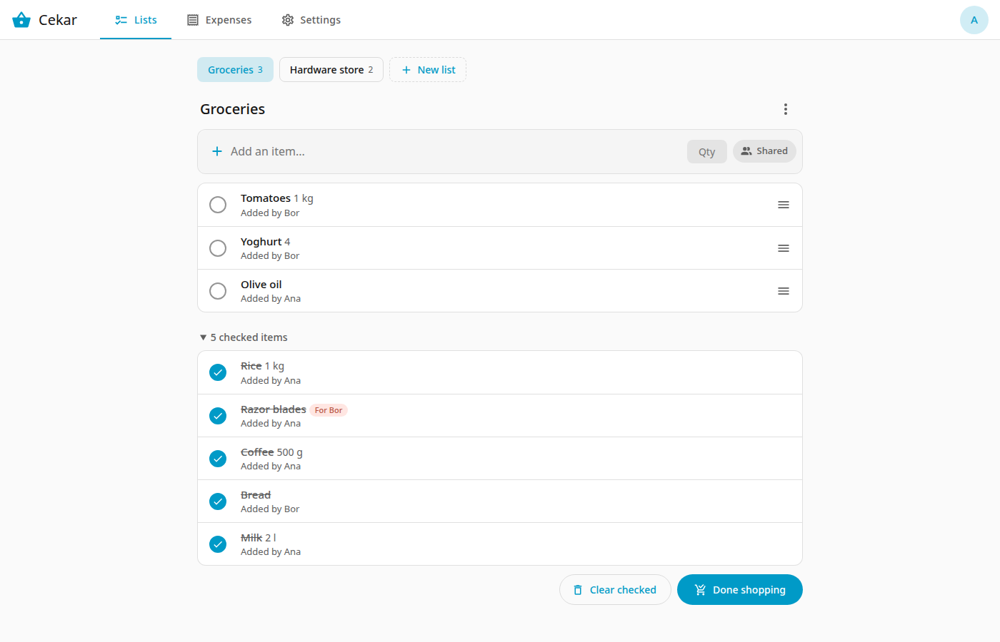
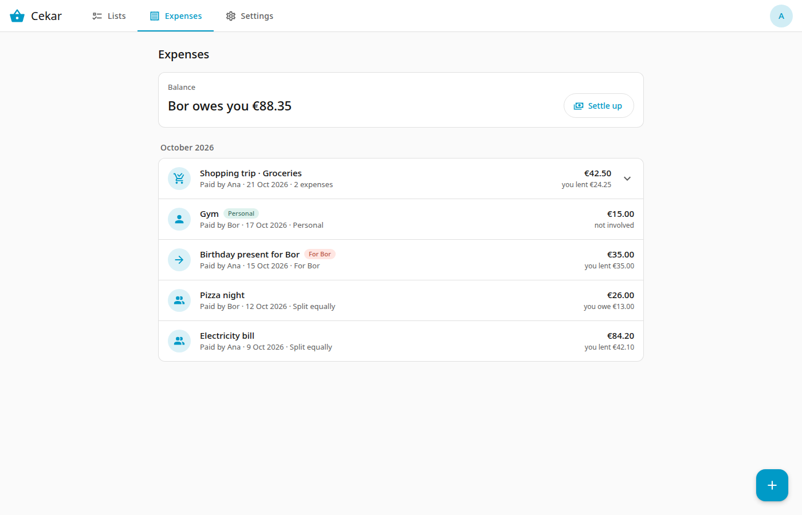
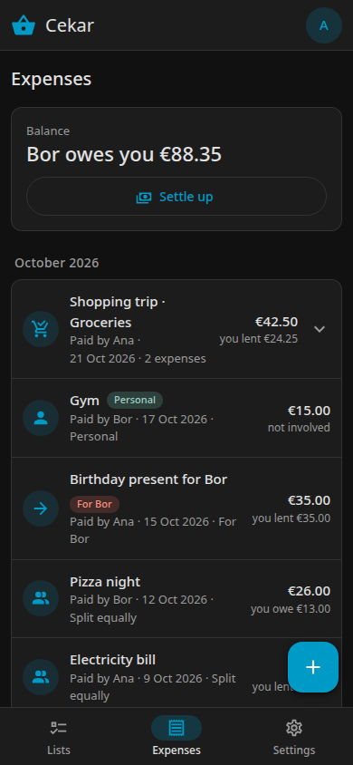

# Cekar

Cekar keeps your household's shopping lists and shared expenses in one place. It replaces a shared Google Keep list and Splitwise, and links the two: when you finish shopping, the checked items and the receipt total become expenses.

It runs as a Home Assistant add-on or as a standalone Docker container.

*A shopping list. Checked items sit in a section below.*

*Balance and expenses, with a shopping trip as one row.*

{ width="260" }
*The same on a phone, in dark mode.*

- **Using Cekar?** Start with the [user guide](user/index.md), or go straight to [Getting started](user/getting-started.md).
- **Working on Cekar?** See the [developer guide](dev/development.md).

!!! note
    Home Assistant, Google Keep and Splitwise are trademarks of their respective owners. Cekar is not affiliated with or endorsed by them.
