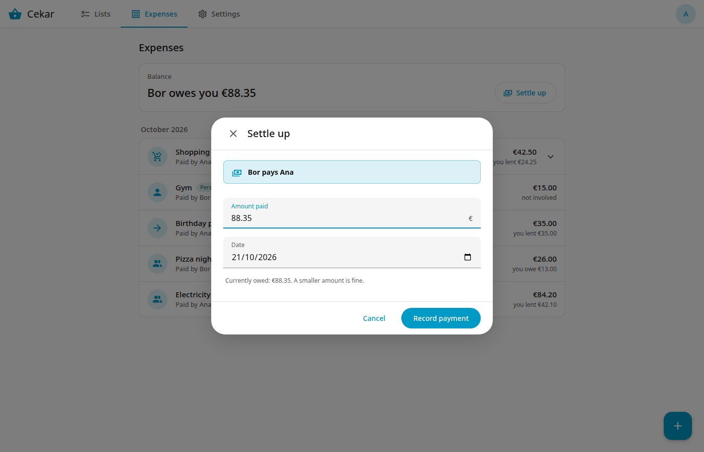

# Balances and settling up

The **Balance** card at the top of the Expenses tab shows who owes whom, for each pair of members. For example: *Bor owes you 88.35*. When nobody owes anything it says *All settled*.

Expenses between two people offset each other: if you owe Bor 10 and Bor owes you 30, the card shows *Bor owes you 20*.

## Settle up

When someone pays back:

1. Press **Settle up** next to the pair.
2. The form shows who pays whom and starts with the full amount. Change **Amount paid** for a partial payment, and the **Date** if needed.
3. Press **Record payment**.

The payment shows in the expense list. Cekar does not move any money; it only records that it happened.

If you enter more than is owed, Cekar warns you first. If you go ahead, the balance turns the other way.

## Fix a mistake

Open the payment in the list to change the amount or date, or to delete it. After a delete, **Undo** is available for a few seconds.
