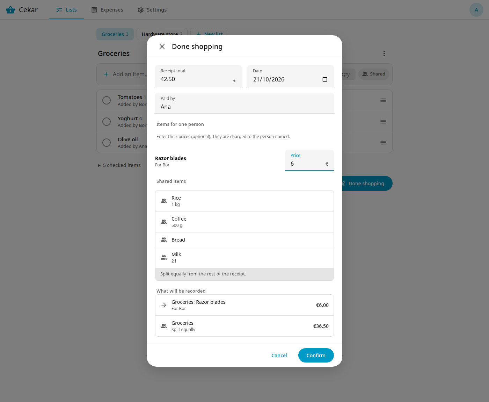

# Done shopping

When you come home, **Done shopping** turns the checked items and the receipt total into expenses and clears the items. The button is on the list page, next to **Clear checked**, once at least one item is checked.

## The form

1. **Receipt total**: what the receipt says.
2. **Date** and **Paid by**: they start as today and you.
3. **Items for one person**: checked items marked "for" a member. Enter a price if you know it. Leave it blank and the item counts as shared.
4. **Shared items**: everything else. They are split equally from the rest of the receipt.
5. **What will be recorded** shows the expenses before you press **Confirm**.

## What gets recorded

- One expense per person who has priced items, charged to that person. If the payer priced items for themselves, that is a **Personal** expense.
- One expense for the rest (total minus the prices), **split equally** among all members.
- The trip shows in the Expenses tab as a single row; open it to see the parts.

## Worked example

Ana and Bor are members. Ana does the shopping from the list "Groceries". Checked: milk, bread, coffee, rice, and razor blades marked "for Bor". The receipt total is 42.50 euro and Ana pays. Bor's razor blades cost 6.00.

| Expense | Amount | Who owes |
|---|---|---|
| Groceries: Razor blades | 6.00 | Bor owes Ana 6.00 |
| Groceries (shared) | 36.50 | Split equally: Bor owes Ana 18.25 |

Bor owes Ana 24.25 for the trip. The trip row reads "you lent 24.25" for Ana.

## Good to know

- The prices of items for one person cannot add up to more than the total.
- With fewer than two members no expense is recorded. Cekar only asks whether to clear the checked items.
- Each part of a trip is an ordinary expense. Open it in the trip row to edit or delete it.
