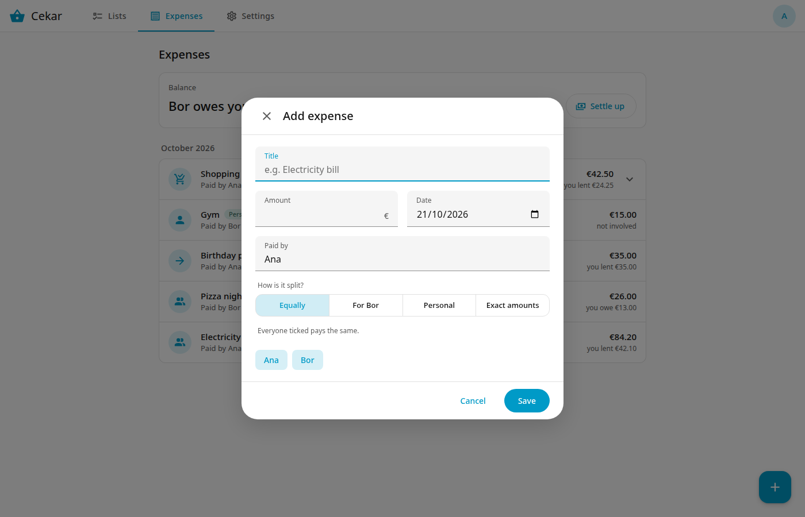

# Expenses

Open the **Expenses** tab. It shows the balance at the top and the expenses below, newest first, grouped by month. Each row says who paid and what your part is: *you owe*, *you lent*, *not shared* or *not involved*.

## Add an expense

Press the **+** button.

Fill in **Title**, **Amount** (a comma or a point both work), **Date** and **Paid by** (starts as you). Then choose **How is it split?**

| Choice | What it does |
|---|---|
| **Equally** | Everyone ticked pays the same. Untick people who are not part of it. |
| **For Bor** | That person owes the full amount. With more than two members it reads **For someone** and you pick the person. |
| **Personal** | Not shared. Nobody owes anything; it is only recorded. |
| **Exact amounts** | You enter what each person owes. The amounts must add up to the total, and the form shows how much is left. |

When an amount cannot be split evenly, the extra cents go to the payer first, so the total always adds up.

## Edit

Tap an expense to open it, change what you want and press **Save**. Balances update at once.

## Delete and undo

Open the expense and press **Delete**. A message with **Undo** appears for a few seconds.
