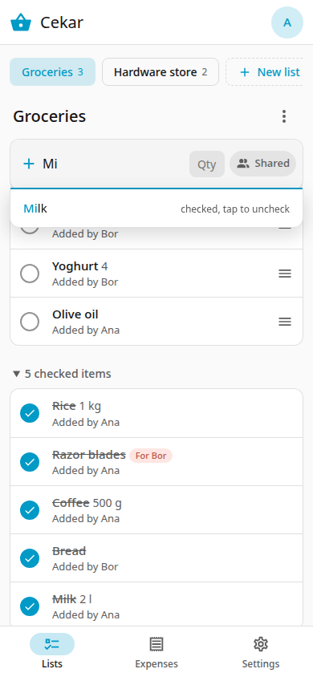

# Shopping lists

Open the **Lists** tab. The chips at the top switch between lists. **New list** adds another one.

## Add an item

Type the name in **Add an item...** and press Enter. Two optional boxes sit on the same line:

- **Qty**: a quantity as free text, for example `2 l` or `500 g`.
- The **Shared** button: choose who the item is for. Only members can be chosen. An item "for" someone is charged to them in [Done shopping](done-shopping.md).

Each item shows who added it.

## Suggestions

While you type, Cekar suggests names from earlier items. Tap one to use it. If the item is already on the list, the suggestion says so; if it was checked, tap it to uncheck it.

{ width="260" }

## Check items

Tap the circle to check an item. It moves to the **checked items** section at the bottom, which you can open and close. Tap the circle again to put it back.

## Edit, reorder, delete

- Tap an item's name to edit the name, quantity or "for whom", or to **Delete** it.
- Drag the handle on the right to reorder unchecked items.
- The three dots next to the list name rename or delete the whole list.

## Clear checked

**Clear checked** removes all checked items from the list. If you went shopping, use [Done shopping](done-shopping.md) instead, which also records the expenses.

## Undo

After deleting an item or a list, or clearing checked items, a message appears with **Undo**. Use it within a few seconds.

## Other people's changes

You do not need to reload. Changes from other household members appear within a few seconds.
