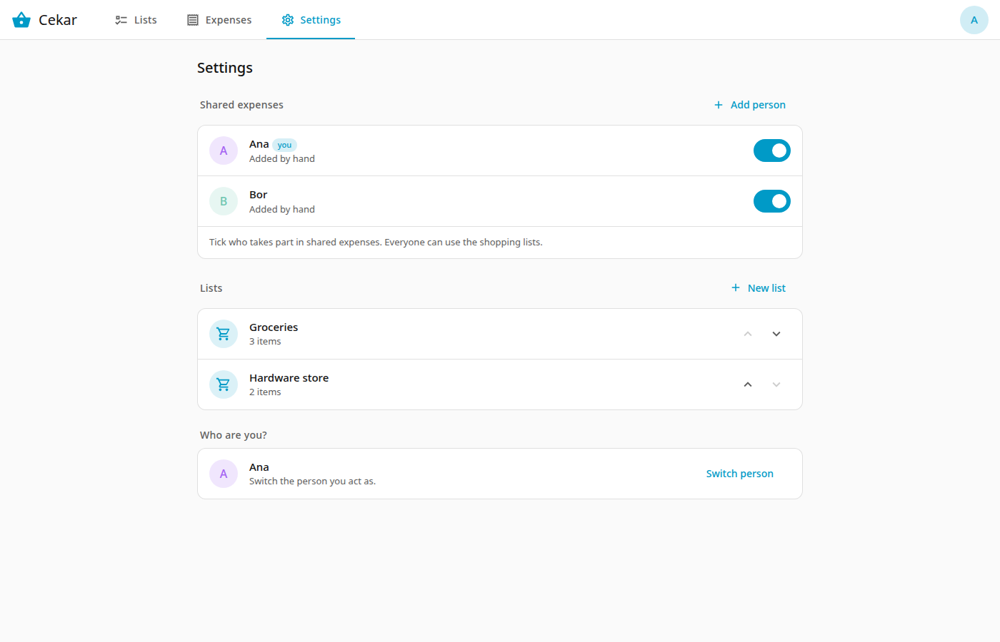

# Settings

## Shared expenses

Everyone who has opened Cekar is listed. Inside Home Assistant, other people appear here once they have opened Cekar; standalone, you add people by hand with **Add person**. Switch a person on to make them a member of shared expenses. Members appear in splits, "for" choices and balances. Everyone can use the shopping lists, member or not.

Turning someone off asks for confirmation only if they have an open balance; otherwise it happens at once. Their history is kept, and a balance they still have stays visible until it is settled.

**Add person** (standalone mode, or when Cekar cannot see Home Assistant users) adds someone by name. They start as a member.

## Lists

Create, rename and delete lists here, and reorder them with the arrows. The order is the order of the chips on the Lists tab.

## Signed in as

Inside Home Assistant this shows the Home Assistant user you are signed in as, and "not a member" if you are not ticked in the list above. You cannot change it here; it follows your Home Assistant login.

## Who are you?

Shown instead of "Signed in as" when Cekar does not get your identity from Home Assistant (standalone mode, or a client that does not pass the user). **Switch person** goes back to the picker.

## Links

At the very bottom are two icon buttons: GitHub (the project page) and Documentation (this guide).
